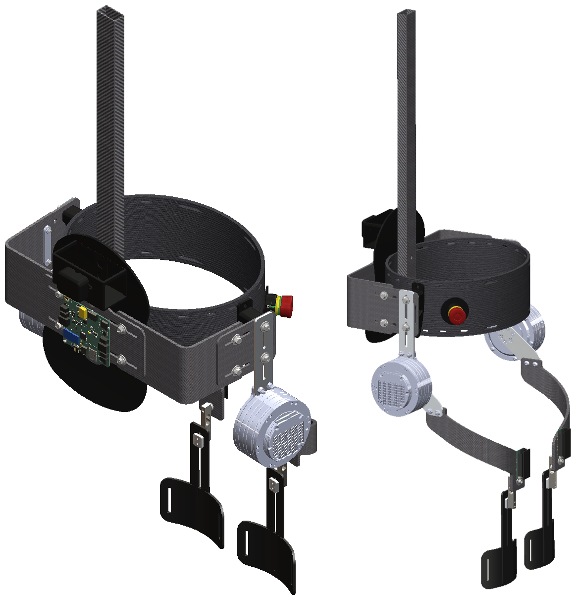

# CAD files

This folder holds the SolidWorks 2022 model of the OpenHi-P exoskeleton: the parts designed for it, models
of its electronics and their mounts, and the assembly `Assmebly.SLDASM`. `DWG/` holds the drawings of the
waterjet-cut plates (CUT-CF-1, CUT-CF-2, CUT-AL-1 to CUT-AL-4 in the building guide), and `STL/` the files of
the printed part 3DP-1, the molds of CF-1 and CF-2, the CNC-machined insert CNC-1, the drilling reference
of CUT-CF-3 and the printed mounts in the table below.

## Electronics and mounts in the model

| File | Part |
|---|---|
| `controller_board.SLDASM` | Controller board (ELE-4); KiCad files in `../Electronics/Controller-Board/` |
| `sensor_node.SLDASM` | Sensor node (ELE-11 with ELE-9 and ELE-3); KiCad files of the carrier in `../Electronics/Sensor-Node/` |
| `Battery Case.SLDPRT` | Battery holder (MNT-2) and the box for the split of the battery lead, screwed onto it (`STL/Battery_holder.STL`, `STL/Battery_split_box.STL`) |
| `eStop.SLDASM`, `eStopCase.SLDPRT` | Emergency stop (ELE-6) on its mount (MNT-3): a ring that holds the switch and a base disc screwed under it (`STL/eStop_mount.STL`, `STL/eStop_mount_bottom.STL`) |
| `Back Plate.SLDPRT`, `Waist Belt.SLDPRT` | Simple models of the back plate of the brace and of the waist belt, which carry these parts |

The two board models contain 3D models from the KiCad libraries, which keep their own license.

How these parts are connected is described in the Electronics section of
`../Hip Exoskeleton Hardware Building Guide.pdf` and shown in the system schematic in `../Electronics/`.

## Commercial parts are not included

The fasteners, the actuators and the emergency-stop switch are commercial parts whose CAD models come from
their vendors, so they are not redistributed here. They are suppressed in `Assmebly.SLDASM` and
`eStop.SLDASM`, so both open without them.

To see the full assembly as in the figure below:

1. Download each part listed below from its vendor and save it in this folder, next to `Assmebly.SLDASM`.
   **SolidWorks resolves references by file name, so save each file under exactly the name listed.**
2. Open `Assmebly.SLDASM`. The commercial parts are suppressed (greyed out in the FeatureManager design
   tree): fasteners at the top level and in the sub-assemblies Actuator, Left Thigh Assembly, Right Thigh,
   Side Connector Assembly, Thigh cuff and Wasit Frame, the actuator in Actuator and the switch in eStop.
   Select them and choose Unsuppress.

*The assembly with the commercial parts in place, seen from the back (left) and from the side (right).*

### McMaster-Carr fasteners

Download from [mcmaster.com](https://www.mcmaster.com) by searching the part number.

| Part number | Description | Save as |
|---|---|---|
| 91116A350 | 18-8 Stainless Steel Oversized Washer | `91116A350_18-8 Stainless Steel Oversized Washer.SLDPRT` |
| 91116A360 | 18-8 Stainless Steel Oversized Washer | `91116A360_18-8 Stainless Steel Oversized Washer.SLDPRT` |
| 91239A144 | Button Head Hex Drive Screw | `91239A144_Button Head Hex Drive Screw.SLDPRT` |
| 91239A232 | Button Head Hex Drive Screw | `91239A232_Button Head Hex Drive Screw.SLDPRT` |
| 91239A318 | Button Head Hex Drive Screw | `91239A318_Button Head Hex Drive Screw.SLDPRT` |
| 91251A345 | Black-Oxide Alloy Steel Socket Head Screw | `91251A345_Black-Oxide Alloy Steel Socket Head Screw.SLDPRT` |
| 91253A197 | Black-Oxide Alloy Steel Hex Drive Flat Head Screw | `91253A197_Black-Oxide Alloy Steel Hex Drive Flat Head Screw.SLDPRT` |
| 91294A192 | Black-Oxide Alloy Steel Hex Drive Flat Head Screw | `91294A192_Black-Oxide Alloy Steel Hex Drive Flat Head Screw.SLDPRT` |
| 94645A102 | High-Strength Steel Nylon-Insert Locknut | `94645A102_High-Strength Steel Nylon-Insert Locknut.SLDPRT` |
| 95947A560 | Aluminum Female Threaded Hex Standoff | `95947A560_Aluminum Female Threaded Hex Standoff.SLDPRT` |
| 97131A120 | Medium-Strength Nylon-Insert Locknut | `97131A120_Medium-Strength Nylon-Insert Locknut.SLDPRT` |
| 98017A640 | 18-8 Stainless Steel Mil. Spec. Washer | `98017A640_18-8 Stainless Steel Mil. Spec. Washer.SLDPRT` |
| 98093A212 | Black-Phosphate Class 10.9 Steel Hex Head Screw | `98093A212_Black-Phosphate Class 10.9 Steel Hex Head Screw.SLDPRT` |
| 98093A316 | Black-Phosphate Class 10.9 Steel Hex Head Screw | `98093A316_Black-Phosphate Class 10.9 Steel Hex Head Screw.SLDPRT` |

### Actuator

| Part | Source | Save as |
|---|---|---|
| CubeMars AK10-9 V2.0 (ELE-1) | CubeMars product page | `AK10-9.SLDPRT` |

### Emergency-stop switch

| Part | Source | Save as |
|---|---|---|
| IDEC XA1E-BV3SG01RH (ELE-6) | IDEC product page (CAD data) | `XA1E-BV3SG01RH.SLDPRT` |

The parts to buy, with their quantities, are listed in `../BOM.csv`, which follows the bill
of materials of `../Hip Exoskeleton Hardware Building Guide.pdf`.
