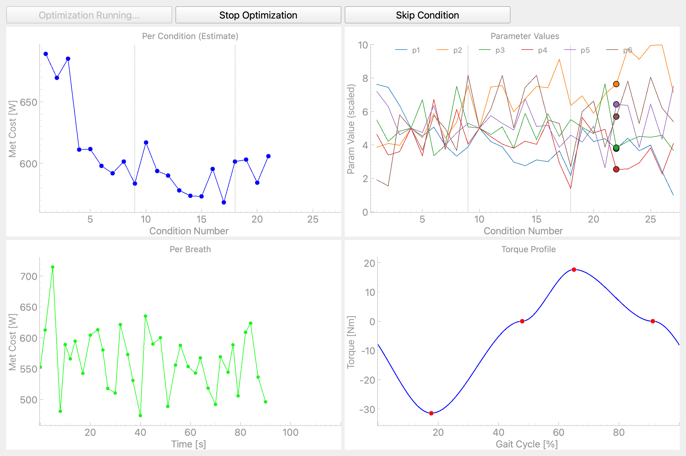

# Optimizer (Host PC)

Host-PC software that optimizes the hip-exoskeleton torque profile with CMA-ES from the metabolic
cost measured in real time by a COSMED indirect-calorimetry system. It reads the breaths off the
COSMED Omnia window (screen capture and OCR) and sends each torque profile to the controller
(`../Controller/`) over Bluetooth Low Energy (BLE).

## Installation

Windows for experiments; the tests and the worked example also run on macOS and Linux.

```bash
git clone https://github.com/Harvard-Slade-Lab/OpenHi-P-Exo.git
cd OpenHi-P-Exo/Optimizer
conda env create -f metcma.yml
conda activate metcma
```

Download the preconfigured Tesseract OCR package
([Google Drive](https://drive.google.com/file/d/17DEtPNnrKnunzDX3ql_moAN2LRDF_OS9/view?usp=sharing))
and extract it here, so that `Optimizer/Tesseract-OCR/tesseract.exe` exists. A run also needs a BLE
adapter, the exoskeleton advertising as `HIP_EXO_MAIN`, and the Omnia window visible on screen.

## Usage

```bash
python main.py
```

The program asks for the subject number and body weight (kg), connects to the exoskeleton, asks you
to draw the Time, VO2 and VCO2 regions on the Omnia window (it exits if no Omnia window is open) and
opens the GUI with live plots.



*The GUI while it runs the worked example (simulated participant of 70 kg; see Tests and worked
example), during the fourth condition of generation 3. Per Condition: the metabolic estimate of each
condition. Parameter Values: the six parameters of each condition on the 0-10 scale of CMA-ES, the
current condition marked. Dashed lines separate the generations. Per Breath: the metabolic rate of
each breath of the current condition. Torque Profile: its torque profile, in Nm.*

- **Start** checks the link (PING) and runs the optimization. **Stop** works at any time: it sends a
  STOP frame ahead of any queued parameters, the controller ramps the assistance to zero in 0.5 s,
  and a condition being collected ends as STOPPED. **Skip** is enabled only while the breaths of a
  condition are collected and ends that condition as SKIPPED.
- **CMA-ES:** eight generations of nine conditions, as in the study, with a time-based seed. Each
  generation includes the best condition of the previous generation (the initial parameters in
  generation 1) and, from generation 2 on, the mirrored pair from which TPA adapts the step size.
  The conditions are presented in order of increasing torque; their costs go back to CMA-ES in the
  order it generated them, with the parameters as presented (within the bounds and after the
  timing constraint).
- **Conditions:** each measurement ends as VALID (the metabolic estimate is its cost), INVALID
  (rule 8 below; a STOP is sent and the GUI shows the reason), STOPPED or SKIPPED. A STOPPED
  condition is measured again at the next Start. An INVALID or SKIPPED condition is measured once
  more with the same parameters (at the next Start after INVALID, right away after Skip); if that
  measurement fails too, the condition is left out of the CMA-ES update and shows as a gap in the
  cost plot. When it is one of the mirrored pair from which TPA adapts the step size, the step size
  is kept for that generation. With fewer than 4 conditions left in a generation the optimization
  stops.
- **Bluetooth:** every frame (PARAMS, STOP, PING) has a sequence number and a CRC-16 and is
  acknowledged by the controller; the host waits 0.5 s for each ACK and sends the frame again up to
  3 times. If a frame is never acknowledged, the optimizer stops running conditions and shows the
  reason. While a controller fault has latched the assistance off, the controller answers with a
  fault status and Start is refused until the controller is reset. Use the firmware and the
  optimizer from the same release.
- **Resuming:** if the subject's `cmaLogFile.csv` exists, the run continues from it: a new CMA-ES
  is told the logged generations again, which gives the same step size and, up to the four
  decimals of the logged parameters, the same mean and covariance.

## Metabolic estimation

The cost of a condition is its steady-state metabolic rate (gross, in W), estimated from the breaths
recorded during the condition (`metabolics_extract.py`, `metabolics_collect.py` and
`process_breath` in `hiloMetCmaController.py`):

1. **Reading:** while a condition is collected, the Omnia window is captured and its Time, VO2 and
   VCO2 regions are read with Tesseract OCR, with a 0.5 s pause before the next capture. A reading
   is a new breath when its time differs from that of the last breath passed on.
2. **Plausibility:** a reading is discarded unless 100 ≤ VO2 ≤ 3000 mL/min,
   100 ≤ VCO2 ≤ 3000 mL/min, 0.6 ≤ VO2/VCO2 ≤ 2.2 and its time is 0 to 30 s after that of the last
   breath passed on. A discarded reading does not change this reference, so after an Omnia time gap
   of more than 30 s, or a misread time accepted as the first breath, no further breath is passed
   on and the condition ends INVALID after 30 s (rule 8).
3. **Energy:** metabolic rate [W] = (16.48 × VO2 + 4.48 × VCO2) / 60, with VO2 and VCO2 in mL/min
   (Brockway equation).
4. **Breaths skipped:** the first 5 breaths after the parameters are sent are not used
   (`breathsToSkip`).
5. **Recording:** from the 6th breath on, each breath is recorded with its time relative to the
   6th breath (Omnia time), if that time is at least 0 s and below 150 s.
6. **Estimate:** made at the first recorded breath that comes more than 120 s after the 6th breath
   with at least 5 breaths recorded (that breath included; `timeToEstimate`, `minBreaths`), from
   every recorded breath. The condition then ends VALID, unless the PING sent next is answered with
   a controller fault (INVALID) or not acknowledged (STOPPED).
7. **Model:** the recorded rates y_i at times t_i are fitted by least squares with
   y_i ≈ x0·a_i + x1·b_i, where a_0 = 1, b_0 = 0 and, with Δt_i = t_i − t_(i−1) and τ = 42 s,
   a_i = a_(i−1)·(1 − Δt_i/τ) and b_i = b_(i−1)·(1 − Δt_i/τ) + Δt_i/τ: a first-order response
   from x0 at the 6th breath toward the steady state x1, which is the estimate. The fit MSE is recorded (`fit_mse`); it does
   not decide whether a condition is VALID.
8. **INVALID:** the estimate is not finite; a breath arrives 150 s or more after the 6th breath
   before an estimate is made (fewer than 5 breaths, or none between 120 and 150 s); no breath was
   skipped or recorded for 30 s (`breathTimeout`, on the PC clock); the metabolics thread has
   stopped; or the PING sent after the estimate reports a controller fault. An INVALID condition is
   measured again at the next Start, and excluded after a second failure (`maxFailures` = 2).

## Output files

The condition log `outcmaes/subject_<N>/subject_<N>_cmaLogFile.csv` has one row per condition:
generation, condition, cost (W; empty unless VALID), step size, parameters `par0`-`par5` as
presented, ask index, state, reason, attempts and fit MSE. `par0`-`par5` are the extension and
flexion peak torque (Nm/kg), then the extension peak time, flexion peak time, mid time and
extension rise time (% gait). The rows with state `proposal` are the generation asked after the
last update (not evaluated); the mean of their parameters is the personalized parameters.

## Tests and worked example

From the repository root:

```bash
python -m unittest discover -s Optimizer/tests -t Optimizer
```

The tests need numpy, pandas, matplotlib, pillow and cma 3.4.0 (in `metcma`; elsewhere
`pip install numpy pandas matplotlib pillow cma==3.4.0`), but no Omnia, Tesseract, BLE device or
display (`tests/_stubs.py` stands in for those modules). They cover the CMA-ES flow, the condition
states, the metabolics thread, the condition log and resuming from it, the run settings, Stop, the
worked example and the Bluetooth protocol, also against the firmware's parser (`Controller/Core/Src/ble_protocol.c`,
compiled with the host C compiler; skipped if none is found).

The worked example runs the optimizer end to end in a few seconds (from `Optimizer/`):

```bash
python -m tests.worked_example --out <new folder> [--generations 8] [--seed 1]
```

The optimization loop, the output files, the Bluetooth frames (sent to a mock controller) and the
metabolic processing are the real code; the Omnia screen and the clock are simulated. The simulated
participant (70 kg) has a known quadratic metabolic landscape over the six parameters (560 W at its
optimum, 611 W at the initial parameters; `tests/worked_example.py`), reached with a 42 s
first-order response and 8 % breath-to-breath noise. The example prints the personalized parameters
next to the initial parameters and the optimum, with the landscape value at each, and writes the
files of a real run. For a given seed, the candidates depend on the numpy build (BLAS/LAPACK).
Simulated inputs exist only under `tests/`: `main.py` exits when the Omnia
window is not found.
