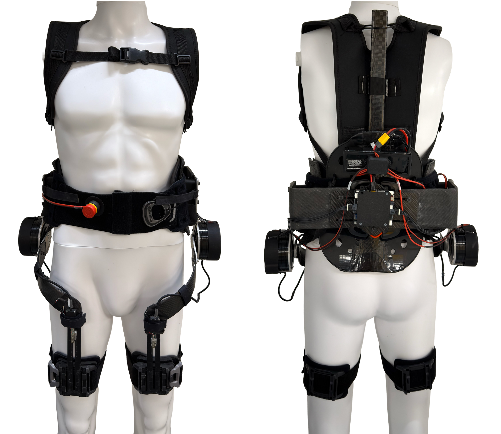
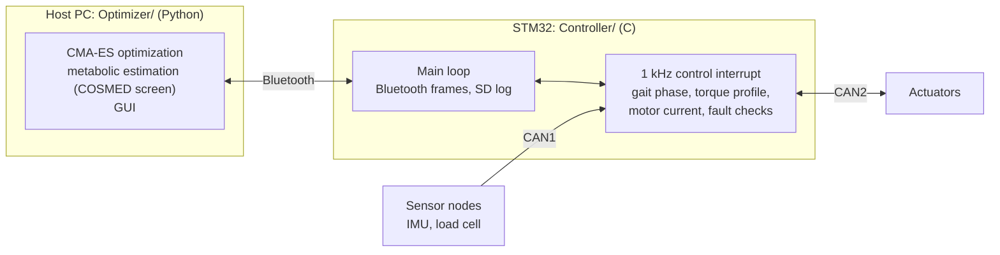
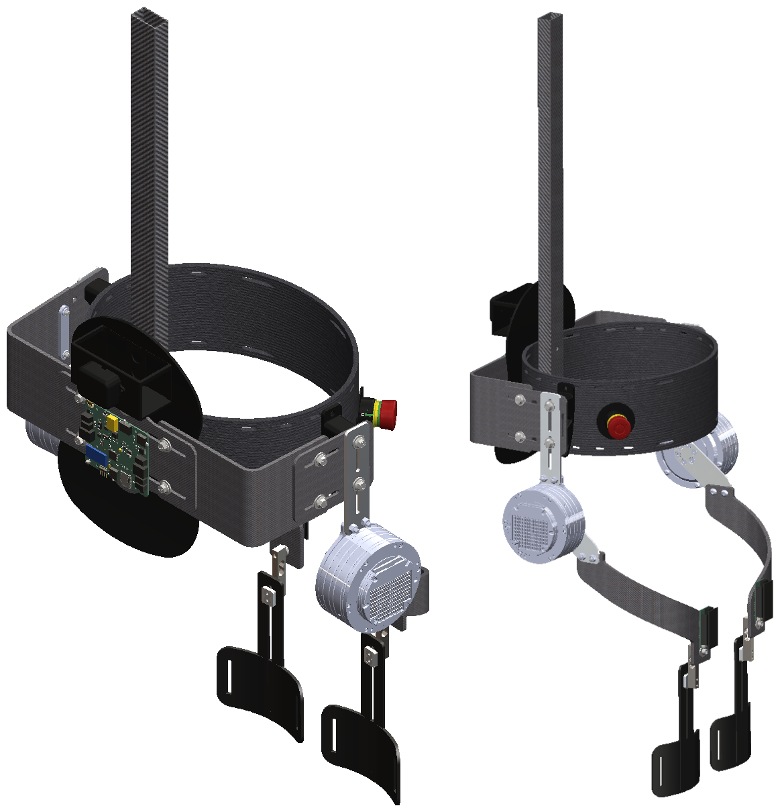
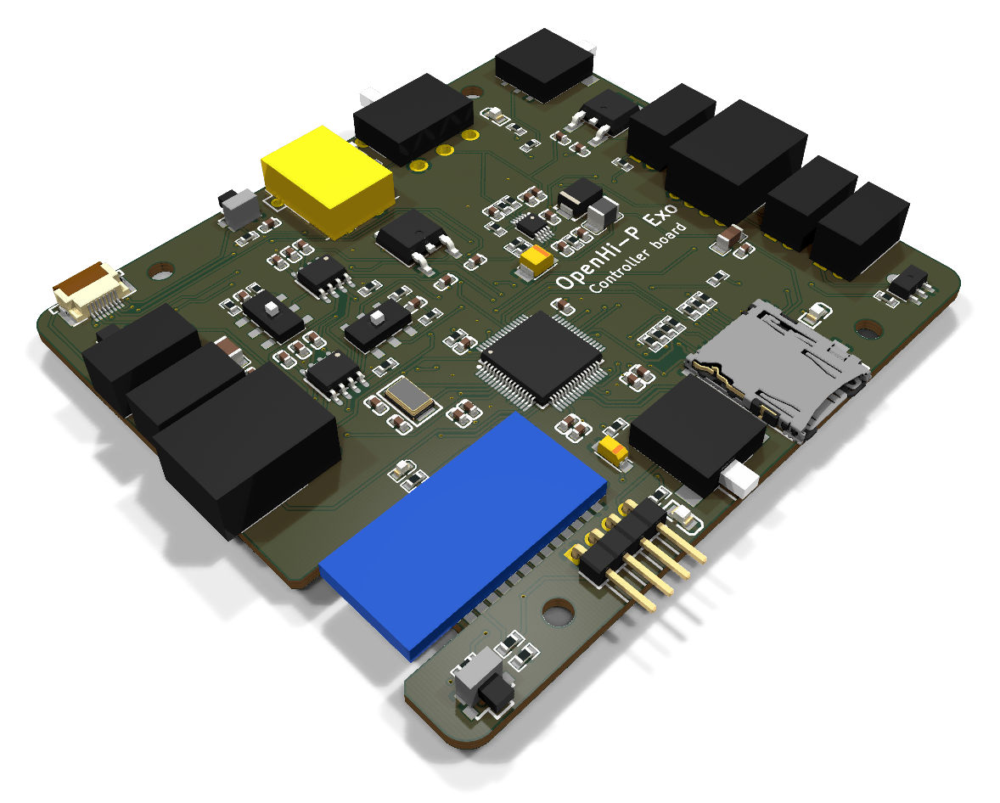
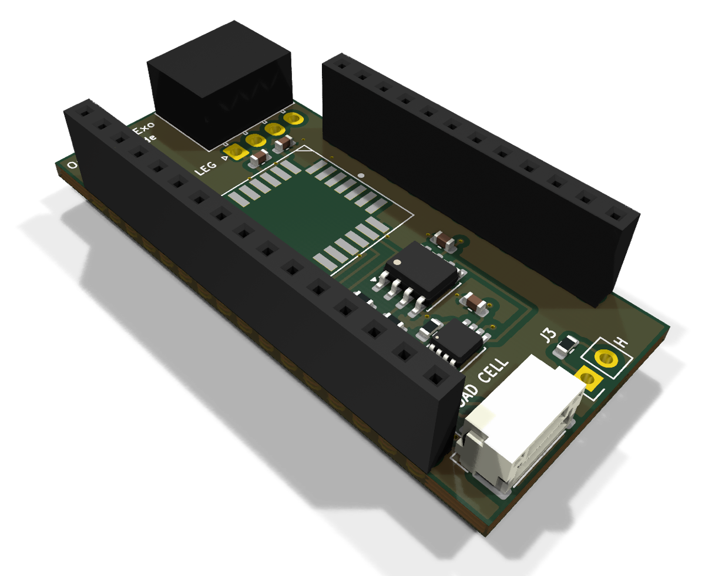

# OpenHi-P Exoskeleton
Open-source, High-torque, and Portable (OpenHi-P) hip exoskeleton

Supplementary materials for "An open-source, high-torque, and portable hip exoskeleton for physically demanding locomotion."

This repository contains the controller firmware, the host-PC human-in-the-loop optimization
software, and the hardware design files with the build guide. The study data and the MATLAB code
that reproduces the figures and statistics are Supplementary Data 1 of the paper, provided with
the article; its README gives the commands.

## Software Overview

| Runs on | Directory | Language / toolchain |
|---|---|---|
| **Host PC** (Windows): human-in-the-loop optimization | `Optimizer/` | Python, conda (`Optimizer/metcma.yml`) |
| **Exoskeleton** (STM32 microcontroller): real-time control | `Controller/` | C, STM32CubeIDE 1.17.0 |
| **Sensor nodes** (Feather M4 CAN Express, one per thigh): IMU and load-cell data to the controller | `Hardware/Electronics/Sensor-Node/firmware/` | C++, Arduino with the Adafruit SAMD core |

### Block diagram of the code

The optimizer sends each torque profile to the controller over Bluetooth; the controller applies it
at 1 kHz from the sensor-node data and drives the actuators.

## Hardware

| CAD model | Controller board | Sensor-node carrier |
|:---:|:---:|:---:|
|  |  |  |

- `Hardware/Hip Exoskeleton Hardware Building Guide.pdf`: bill of materials, fabrication, assembly and electronics.
- `Hardware/BOM.csv`: bill of materials with the electronics, connectors and cables (unit prices in US dollars).
- `Hardware/CAD/`: SolidWorks 2022 model, drawings of the cut parts and STL files of the printed parts.
  Commercial parts (fasteners, actuators, emergency-stop switch) are not included; `Hardware/CAD/README.md`
  lists where to get them.
- `Hardware/Electronics/`: system schematic ([PDF](Hardware/Electronics/OpenHipExo_system.pdf), KiCad 10);
  KiCad and fabrication files of the controller board (`Controller-Board/`) and of the sensor-node carrier
  (`Sensor-Node/`), and the sensor-node firmware (`Sensor-Node/firmware/`).

## Controller (Firmware)

- STM32F446 firmware in C: gait phase estimation, torque profile, motor current control, CAN and
  Bluetooth communication, SD-card logging and fault checks.
- Build and flash with STM32CubeIDE 1.17.0 (building guide, "Import, build, and flash the firmware");
  host tests (need a C compiler): `bash Controller/Tests/run_tests.sh`.
- Bluetooth: the optimizer sends CRC-checked PARAMS, STOP and PING frames, and the controller
  acknowledges each (`Controller/Core/Inc/ble_protocol.h`). Use the firmware and the optimizer from the
  same release.

## Optimizer (Host PC)

- Python (conda environment `Optimizer/metcma.yml`): CMA-ES optimization of the torque profile from the
  metabolic cost measured in real time.
- Runs on Windows (screen capture of the COSMED Omnia window); the tests and the worked example also run
  on macOS and Linux.
- Run with `python main.py`; `Optimizer/README.md` gives the installation (with the Tesseract OCR
  setup), usage, metabolic estimation, tests and worked example.

## Repository Structure

- `Controller/`: STM32CubeIDE project (sources in `Core/Src/`, headers in `Core/Inc/`)
  - `main.c`: start-up, 1 kHz control interrupt and main loop; `globals.c`: shared data
  - Control: `control_logic.c` (gait phase), `torque_profile.c`, `torque_calculation.c`, `motor_control.c`
  - Communication: `can_rx_callback.c`, `imu_processing.c`, `servo_receiving.c`, `servo_sending.c` (CAN); `ble_protocol.c` (Bluetooth)
  - Safety and logging: `fault_monitor.c`, `sd_card.c`, `FATFS/`
  - Peripheral and system files generated by STM32CubeMX from `Open Hip Exo.ioc` (`can.c`, `tim.c`, `usart.c`, ...)
  - `Tests/`: host tests (`run_tests.sh`): protocol parser, fault monitor, torque profile, phase mapping
- `Hardware/`: see Hardware above.
- `Optimizer/`: host-PC optimization (Python)
  - `main.py`: entry point (GUI, Bluetooth, metabolic data, controller link)
  - `hiloMetCmaController.py`, `cma_optimizer.py`: optimization loop and CMA-ES (pycma 3.4.0)
  - `metabolics_collect.py`, `metabolics_extract.py`: metabolic data from the COSMED screen
  - `bleFunctions.py`: Bluetooth link
  - `serialPlotter.py`, `param_utils.py`, `timer_manager.py`: plots and utilities
  - `metcma.yml`: conda environment; `tests/`: tests and the worked example

## Citation

To cite this repository, use `CITATION.cff` ("Cite this repository" on GitHub). Release v1.0.0 is archived at Zenodo.

## License

This project is released under the MIT License; see `LICENSE`. The license covers
the firmware in `Controller/Core/` and its host tests in `Controller/Tests/`, the
host-PC optimization code in `Optimizer/`, and the hardware design files created for
this project: `Hardware/CAD/`, `Hardware/Electronics/`
(including the sensor-node firmware) and `Hardware/BOM.csv`.

Three exceptions:

- Third-party components vendored under `Controller/Drivers/` and
  `Controller/Middlewares/` remain under their own licenses. CMSIS is Apache-2.0,
  the STM32F4xx HAL driver is BSD-3-Clause, and FatFs is under the ChaN one-clause
  BSD license. CMSIS and the HAL driver carry their own LICENSE.txt; the FatFs terms
  are stated in the headers of its source files.
- Commercial off-the-shelf CAD models are not redistributed here and are not covered
  by this license; see `Hardware/CAD/README.md`.
- Symbols, footprints and 3D models from the KiCad libraries, used in the board files,
  the board images and the board models in `Hardware/CAD/`, keep the license of the KiCad libraries.
